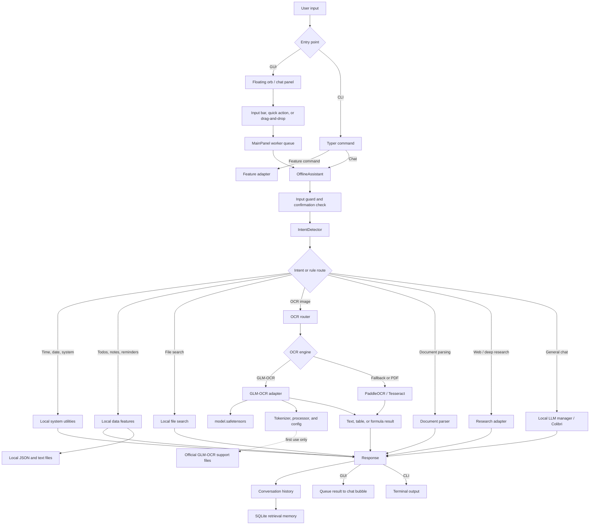
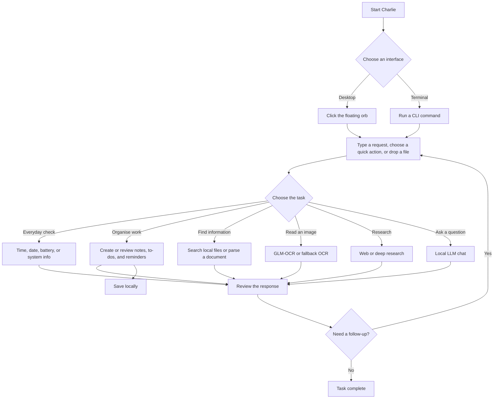
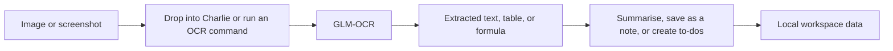

# Charlie — Local-First AI Assistant

Charlie is a desktop and command-line assistant for everyday work: local chat,
notes, to-dos, reminders, file discovery, document extraction, and image OCR.
It runs primarily on your machine and keeps user data in local storage.

> Optional features such as web research and first-run GLM-OCR support-file
> setup require network access. They are never required for the local workflow.

## 🚀 Quick Start

```bash
# Install dependencies
pip install -r requirements.txt

# Run the GUI
python main.py

# Run the CLI
python -m cli.main --help
# or: charlie --help  (after pip install)

# Interactive chat mode
python -m cli.main chat start
```

## 🔀 Workflows

### Project data pipeline



### Your day-to-day workflow



### Image-to-text workflow



## 📦 What's Charlie?

Charlie combines a small local-first workspace with a flexible assistant layer:

- **💻 CLI Mode**: Full-featured command line interface with Rich output
- **🖥️ GUI Mode**: Futuristic glassmorphism floating orb + chat panel
- **🧠 Local LLM**: Powered by llama-cpp-python + GGUF models, or **Colibri** (MoE engine)
- **🔊 TTS**: pyttsx3 (default); a Piper wrapper is included but not wired in
- **📁 File management**: Search, notes, todos, reminders
- **📊 System info**: CPU, memory, battery status
- **🔍 Web Search / Deep Research**: GPT Researcher + DuckDuckGo + Wikipedia fallback
- **🖼️ OCR**: Local GLM-OCR for images, with PaddleOCR/pytesseract fallback and PDF support
- **📄 Document Parsing**: Convert PDF, DOCX, PPTX, XLSX, HTML, EPUB and more to Markdown via Docling
- **🤖 Colibri LLM**: Run huge MoE models (GLM 744B, DeepSeek, Qwen3, OLMoE) locally at ~10 GB RAM

## 📋 Commands

### CLI (`python -m cli.main` or `charlie`)

| Category | Commands |
|----------|----------|
| **Time/Date** | `time now`, `date today` |
| **System** | `system info`, `system battery` |
| **Files** | `file find <q>`, `file search <path> <q>` |
| **Notes** | `note create <title> <content>`, `note list`, `note search <q>`, `note show <path>` |
| **Todos** | `todo add <task> --priority high`, `todo list --all`, `todo done <id>`, `todo remove <id>`, `todo search <q>` |
| **Reminders** | `remind add <text> --in <minutes>`, `remind list` |
| **Apps** | `app open <name>` |
| **Chat** | `chat start [--voice/--no-voice]` |
| **Web Search** | `search run <query>`, `search deep <topic>` |
| **OCR** | `ocr run <image_or_pdf>`, `ocr glm <image> --task text`, `ocr info` |
| **Document Parse** | `parse run <file_or_url>`, `parse run <file> --summary`, `parse info` |
| **Colibri LLM** | `colibri status`, `colibri start`, `colibri stop`, `colibri models`, `colibri chat "<msg>"` |
| **Config** | `config`, `version` |


### GUI (`python main.py`)

- Floating orb widget (draggable, click-to-toggle panel)
- Glassmorphism chat panel with message bubbles
- Quick action buttons (Time, Date, Todos, System, Battery, Notes)
- Input bar with send button + microphone placeholder
- System tray integration
- Reminder notifications

## 📁 Project Structure

```
OFFLINE_AI_ASSISTANT/
├── main.py                 # Application entry point (GUI)
├── cli/                    # Charlie CLI package (Typer + Rich)
│   ├── __init__.py
│   ├── main.py             # CLI entry point
│   ├── core.py             # FeatureRegistry + EventBus singleton
│   ├── utils.py            # Rich formatters and helpers
│   └── commands/           # Individual command modules
│       ├── __init__.py
│       ├── time_date.py
│       ├── system.py
│       ├── files.py
│       ├── notes.py
│       ├── todos.py
│       ├── reminders.py
│       ├── apps.py
│       └── chat.py
├── assistant.py            # Core assistant (FeatureRegistry + EventBus + feature delegation)
├── config.py               # Configuration management (JSON + .env)
├── model.py                # ModelManager + LlamaCppEngine for GGUF
├── core/                   # Core infrastructure
│   ├── __init__.py
│   ├── events.py           # EventBus + event types
│   ├── registry.py         # FeatureRegistry
│   └── base.py             # BaseFeature, Command, CommandResult, FeatureConfig
├── features/               # Extracted feature modules
│   ├── system_info/        # SystemInfoFeature
│   ├── notes/              # NotesFeature
│   ├── todos/              # TodosFeature
│   ├── reminders/          # RemindersFeature
│   ├── file_search/        # FileSearchFeature
│   └── tts/                # PiperTTS wrapper (optional)
├── intent.py               # IntentDetector for command routing
├── memory.py               # RetrievalMemory for conversation history
├── ui/                     # Tkinter glassmorphism UI package
│   ├── __init__.py
│   ├── main_panel.py       # Main chat window
│   ├── floating_widget.py  # Draggable orb widget
│   ├── chat_area.py        # Scrollable message bubbles
│   ├── input_bar.py        # Text input + send controls
│   ├── quick_actions.py    # Shortcut command buttons
│   ├── widgets.py          # Reusable UI primitives
│   ├── theme.py            # Design system (colors, fonts)
│   └── animations.py       # Animation engine
├── config.json             # Main application configuration (llama settings)
├── requirements.txt        # Python dependencies (typer, rich, llama-cpp-python, etc.)
├── pyproject.toml          # Package config with charlie console script
└── .gitignore
```

## 🛠️ Installation

```bash
# Install dependencies
pip install -r requirements.txt

# Optional: Install charlie as console script
pip install -e .

# Run the GUI
python main.py

# Run the CLI
python -m cli.main --help
# or simply: charlie --help
```

## 🧠 Local LLM Setup

Charlie uses **llama-cpp-python** for local GGUF model inference.

1. Install the package: `pip install llama-cpp-python`
2. Place a `.gguf` model file in `./models/` or set `model_directories` in `config.json`
3. Charlie will discover and load the model automatically

Example `config.json`:
```json
{
  "default_model": "qwen3-1.7b-q4_k_m.gguf",
  "model_directories": ["./models"],
  "llama": {
    "context_size": 2048,
    "threads": 4,
    "gpu_layers": 0,
    "temperature": 0.7
  }
}
```

## 🖼️ GLM-OCR setup

The bundled `models/image_to_text/model.safetensors` is the local
[GLM-OCR](https://huggingface.co/zai-org/GLM-OCR) image-to-text model. On its
first use Charlie downloads the model's small tokenizer, processor, and
configuration files from the official repository; the 2.65 GB weight file is
already local and is never downloaded again.

When installing as a package instead of from `requirements.txt`, install the
OCR runtime with `pip install -e ".[glm-ocr]"`.

```bash
# Recognise normal text, a formula, or a table in an image.
python main.py ocr glm path/to/scan.png --task text
python main.py ocr glm path/to/equation.png --task formula
python main.py ocr glm path/to/table.png --task table
```

Set `"ocr_engine": "glm_ocr"` in `config.json` to require GLM-OCR for chat
and drag-and-drop image OCR. The default `"auto"` setting uses GLM-OCR when
its runtime is available and otherwise falls back to PaddleOCR or Tesseract.
GLM-OCR needs substantial RAM or VRAM; use the fallback engine on lower-memory
machines. PDFs continue through the existing OCR pipeline.

## 🛡️ Privacy and safety

- **Local-first** — notes, tasks, reminders, and retrieval memory stay in the configured data directory.
- **No telemetry** or tracking
- **User-controlled integrations** — web research and the first GLM-OCR support-file download are optional network paths.
- **Configuration-driven** — feature flags and model settings are controlled through `config.json`.

## 📁 Data Storage

All user data resides in the configured `data_dir` (by default, `offline_assistant_data` in the current user's home directory):
- `chat.db` - SQLite conversation history
- `notes/` - Text note files
- `todo.json` - To-do list
- `reminders.json` - Scheduled reminders
- `config.json` - User configuration

## 🛠️ Extensibility

Adding new features is straightforward:

1. Create `features/<name>/<name>.py` with a class extending `BaseFeature`
2. Register the feature in `FeatureRegistry` (or `OfflineAssistant.__init__`)
3. Add commands to the feature's `commands` dict
4. The feature auto-appears in both GUI and CLI

## 🧪 Development

```bash
# Run the project test suite
python -m pytest tests -q

# Inspect all CLI commands
python main.py --help
```

## 📜 License

MIT License - see the LICENSE file for details.

## 🙏 Acknowledgments

- [llama-cpp-python](https://github.com/abetlen/llama-cpp-python) for GGUF inference
- [pyttsx3](https://pypi.org/project/pyttsx3/) for offline TTS
- [Typer](https://typer.tiware.dev/) for the CLI framework
- [Rich](https://rich.textualize.io/) for terminal output formatting
- [Ollama](https://ollama.ai/) for model ecosystem
