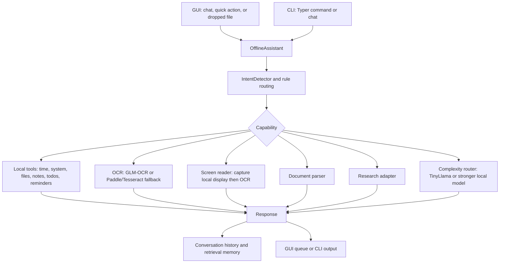

# Current Architecture

Charlie is a local-first Python assistant with two interfaces: a Tkinter
desktop assistant and a Typer CLI. `README.md` is the user-facing overview;
this document describes the implementation boundary and data movement.

## Request flow

## Main components

| Area | Current implementation |
| --- | --- |
| Entry point | `main.py`: GUI with no arguments, CLI otherwise |
| Orchestrator | `core/assistant.py` (`OfflineAssistant`) |
| Intent routing | `core/intent.py` plus strict command rules in the assistant |
| Desktop UI | `ui/`: floating orb, panel, input bar, quick actions, drag/drop |
| CLI | `cli/main.py` and `cli/commands/` using Typer |
| Local chat | `models/model.py` with `llama-cpp-python` and GGUF assets |
| Model delegation | Colibri is preferred for free-form chat whenever its local server is available. Otherwise `core/complexity.py` sends simple chat to TinyLlama and long, multi-step, code/structured, or analytical requests to the configured complex route. A missing explicit route returns an error rather than silently downgrading. |
| Alternative local server | `features/local_llm/colibri_adapter.py` |
| Image OCR | `features/ocr/glm_ocr_adapter.py`, then PaddleOCR/Tesseract fallback |
| Screen reading | `features/screen_reader/`: explicit primary-display capture (or all displays by configuration) followed by the configured local OCR adapter; captures are deleted after OCR by default |
| Documents | `features/document_parser/docling_adapter.py` with fallback extractors |
| Research | `features/web_search/gpt_researcher_adapter.py`; optional online path |

## Storage and lifecycle

`data_dir` is configurable in `config.json`; its default is a directory under
the user's home folder. It holds `chat.db`, `notes/`, `todo.json`,
`reminders.json`, `ocr/`, `screens/`, and `documents/`. `screens/` receives
only user-requested desktop captures when retention is explicitly enabled;
temporary captures are removed immediately after OCR. Notes and JSON records are written
by their feature modules. Retrieval memory persists conversation summaries in
SQLite. Reminder checking runs in a daemon thread and marshals GUI updates back
to the Tk thread.

Models are not application data: GGUF assets live in `models/`, while the
GLM-OCR weight is `models/image_to_text/model.safetensors`. They are excluded
from Git because of their size.

## Boundaries

Core productivity features run without network access. Research and the
first-time download of GLM-OCR processor/tokenizer/config files are optional
network paths. Optional adapters degrade with a useful message rather than
preventing the assistant from starting.
